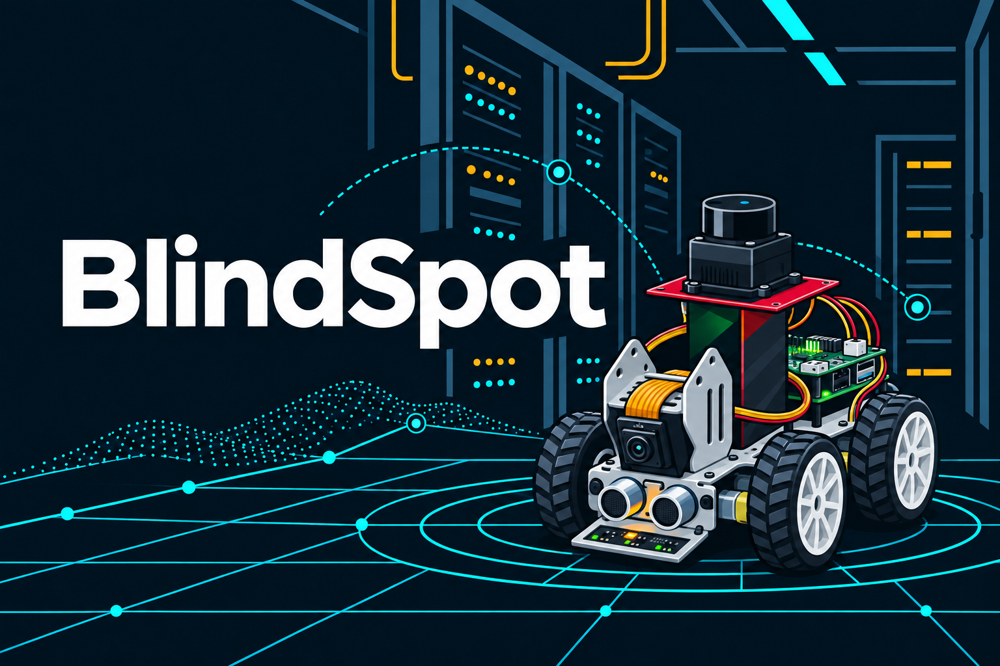
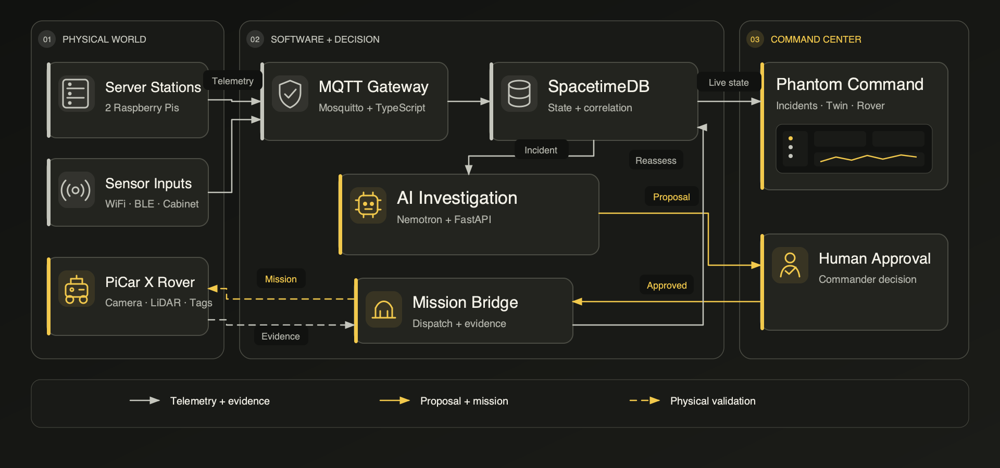
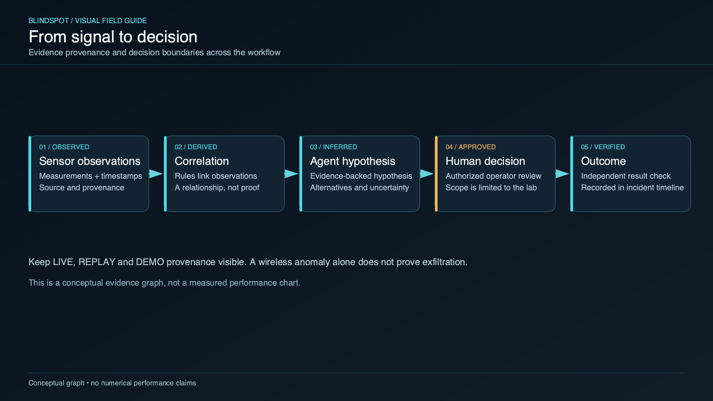

*Concept illustration based on the rover prototype.*

# BlindSpot

### An alert should lead to evidence, not more guesswork.

A suspicious network flow appears on Pi 02. Most security tools stop at the alert. BlindSpot validates the observation, connects it to an incident, investigates the stored evidence, and requests a targeted inspection. A human Commander decides whether the rover goes anywhere.

That last part matters. The AI can propose a mission. It cannot approve one, move motors directly, or change network defenses on its own.

**Built for HackUTD 2026** · NVIDIA Nemotron × SpacetimeDB × Raspberry Pi × PiCar X

> **8 stage workflow** · **6 connected workspaces** · **2 Raspberry Pi servers** · **DEMO, REPLAY, and LIVE labels**

[GitHub repository](https://github.com/ch1kim0n1/hackutd26)

***

## Inspiration: the alert was never the whole story

Server logs, network flows, sensor readings, and the physical rack usually live in separate tools. When something looks wrong, responders have to reconstruct the context themselves. Which event came first? What else changed? Which machine needs attention? Is anyone actually looking at it?

We built BlindSpot around those questions. Keep the evidence connected. Give the investigator narrow tools. Require human approval before action. Use the rover when a dashboard cannot answer the question.

* **Suspicious flow:** BlindSpot keeps the signed observation and related incident history.
* **Unexpected service:** The investigator uses stored facts, not a generated guess.
* **Possible physical issue:** A bounded inspection request points to a registered target.
* **Completed inspection:** Hashed evidence supports a fresh assessment.

***

## What it does

*High level operating loop. Dashed paths show physical mission validation still in progress.*

1. **Observe.** Devices report health, services, resource use, network flows, and configuration facts. Physical Pis and simulated nodes use the same observation contract.
2. **Validate.** The gateway checks MQTT identity, schema, payload size, sequence freshness, and an HMAC SHA256 signature over canonical JSON. Bad or replayed packets are rejected.
3. **Correlate.** SpacetimeDB rules turn meaningful anomalies into incidents. Healthy metrics and ordinary high CPU do not trigger repeated investigations.
4. **Investigate.** The investigator reads stored observations through scoped tools. Its assessment must point back to that evidence.
5. **Authorize.** A Commander reviews the proposed inspection. Approval happens outside the model.
6. **Inspect.** The mission runtime resolves a registered target and surveyed location, then returns structured inspection evidence.
7. **Reassess.** Evidence enters the incident with hashes and storage references. The investigator runs again with the new information.
8. **Visualize.** Phantom Command shows the incident, device state, rover status, evidence, and 3D occupancy map with clear provenance.

### Inside Phantom Command

* **Command Overview:** Facility posture, incidents, telemetry, device health, and rover status.
* **Digital Twin:** Interactive 3D racks, occupancy geometry, rover routes, cameras, and spatial overlays.
* **Network Intelligence:** Device inventory, filters, risk context, topology, and observations.
* **Incident Center:** Evidence, findings, timelines, related devices, and approval history.
* **Rover Operations:** Camera and LiDAR displays, mission state, telemetry, waypoints, and stop controls.
* **Nemotron Intelligence:** Investigation steps, tool calls, citations, confidence, and policy decisions.

Live mode is read only. Demo controls, simulated missions, and physical rover authority stay separate.

***

## Where the AI stops

*Observed, derived, inferred, approved, and verified states stay distinct.*

The thing is, a confident model response is not evidence. BlindSpot keeps those roles separate:

* **Devices supply observations.** Identity specific MQTT accounts, ACLs, signatures, and sequence checks protect the input path.
* **Rules create correlations.** A correlation connects observations. It does not prove an attack.
* **The investigator forms a hypothesis.** It gets bounded tools and stored evidence, not an arbitrary shell.
* **A human approves action.** Server side policy checks the request before any mission proceeds.
* **The result goes back on record.** Artifacts include hashes, storage references, mission context, and provenance.

A wireless anomaly alone does not prove exfiltration. Simulated and replayed data keep their labels. The twin also labels inferred geometry. Extruding a 2D occupancy grid into 3D does not turn wall heights into LiDAR measurements.

***

## How we built it

* **Device and test data:** Python datacenter simulator, physical Raspberry Pi publishers, service monitors, network flows, and configuration observations.
* **Messaging:** Mosquitto MQTT, separate topics and ACLs for each device, TLS for physical Pis, canonical JSON, and HMAC SHA256.
* **Gateway:** TypeScript and Node.js for validation, normalization, signature checks, deduplication support, and sequence state.
* **Backend state:** SpacetimeDB reducers, tables, and subscriptions for devices, observations, incidents, missions, approvals, and evidence.
* **Investigation API:** FastAPI orchestration with authorization, audit, policy checks, scoped tools, and mission requests.
* **Model provider:** NVIDIA Nemotron through the hosted endpoint, with a deterministic scripted provider for repeatable tests.
* **Rover connection:** Python mission runtime, authenticated `inspect_cabinet` commands, registered targets, hashed reports, and a PiCar X adapter that fails closed.
* **Command center:** React, TypeScript, Vite, Three.js, React Three Fiber, Drei, ECharts, Zustand, Radix UI, and Tailwind.
* **Testing and local services:** Docker Compose, pytest, Vitest, Playwright, TypeScript checks, and integration runbooks.

The same contracts support deterministic demos, real local services, and physical server telemetry. That let us test the workflow before every hardware component was ready.

***

## What works today

We tested different parts at different levels. Each result below includes its limit.

* **Local incident loop:** Two fresh runs went from suspicious flow to incident, inspection request, human approved simulated mission, attached evidence, and reassessment. This used signed simulated telemetry, a simulated rover, and a scripted AI provider. Live Nemotron and physical dispatch were not part of these runs.
* **Local services:** Mosquitto, gateway, SpacetimeDB, FastAPI, mission bridge, and rover evidence flow ran together. This was a local lab deployment, not production infrastructure.
* **Physical Pi telemetry:** Two Pis sent actual local measurements with distinct HMAC keys and MQTT accounts over TLS. The gateway accepted them and matching database rows appeared. A complete physical investigation workflow remains unfinished.
* **Controlled detection:** An approved listener on Pi 02 created an incident. Its alert cleared after the listener stopped. An operator still needs to triage and close the incident.
* **Rover sensors:** Real camera video reached Rover Operations through a loopback SSH tunnel. The MS200 LiDAR produced real stationary scans. Physical mission dispatch and a live SLAM map and pose feed remain unverified.
* **Digital twin:** Occupancy data rendered as interactive 3D geometry in Chromium, with coordinate frames and provenance. Wall heights are estimated, not measured.

Unit, service integration, type, build, and browser checks cover the command center and supporting packages. Those tests do not substitute for a production security review.

Still in progress: live Nemotron acceptance, physical dispatch and reassessment, AprilTag recognition, calibrated autonomous inspection, and real LiDAR SLAM registration.

***

## Challenges: honestly, the contracts caused most of our bugs

Individual components passed their tests and still failed together. These fixes mattered most:

1. **Valid signatures failed.** Python wrote `95.0` while JavaScript produced `95`. We aligned number canonicalization before signing and verification.
2. **Every mission was rejected.** Expiry used milliseconds while SpacetimeDB expected microseconds. We fixed the conversion and lifecycle validation.
3. **Mission tracking stopped.** `Completed` and `completed` did not match. We normalized enum tags at the bridge boundary.
4. **Evidence disappeared.** Artifact discovery missed nested inspection directories. We fixed discovery and metadata verification.
5. **Restarts blocked evidence attachment.** An in memory grant cache vanished. The bridge now checks for the persisted grant idempotently.
6. **Reassessment did not rerun correctly.** The scripted model fork kept its old state. Each investigation now gets a fresh fork. Live providers remain stateless.

The lesson was direct: shared contracts deserve as much testing as the code on either side.

***

## Accomplishments we are proud of

* **Two complete local incident loops.** Each ran from signed telemetry through approval, inspection evidence, and reassessment.
* **Targets chosen from evidence.** The investigator selects a registered target from observations instead of following a hardcoded demo destination.
* **Physical data in the system.** Two Pi stations, a controlled listener detection, rover camera video, and real LiDAR scans are validated at their respective boundaries.
* **Controls on automation.** Model reasoning, human authorization, motor control, and network response remain separate.
* **A working 3D twin.** Browser tests cover occupancy geometry, coordinate handling, and provenance display.

***

## What we learned

**Evidence beats more alerts.** Responders need sources, alternatives, and uncertainty. Another red panel does not provide them.

**Small contract differences cause large failures.** Number formats, clocks, enum casing, identity enrollment, and stale data all broke otherwise working paths.

**Simulation is useful when its labels are honest.** It helped us debug the workflow early. It did not count as physical acceptance.

**3D needs restraint.** The twin helps people orient themselves, but inferred wall heights and unregistered coordinates must stay visible as limitations.

***

## What's next for BlindSpot

1. **Run live Nemotron acceptance.** Test evidence citations, tool calls, uncertainty, and policy behavior against the hosted model.
2. **Finish physical missions.** Verify PiCar X dispatch, abort, independent stop, watchdog behavior, and calibrated movement.
3. **Capture physical inspection evidence.** Validate AprilTags, registered cabinet targets, camera artifacts, and the next investigation cycle.
4. **Connect real spatial data.** Stream calibrated SLAM occupancy and rover pose into the twin with frame registration and stale data handling.
5. **Repeat the full physical workflow.** Run observation, incident, approval, inspection, evidence, and reassessment on one authorized network.
6. **Test scoped containment later.** Keep it behind human approval and independent outcome checks.

***

## Why it matters

Responders need to know where a claim came from, who approved the action, and what happened next. BlindSpot keeps those links intact, from the first observation to the final inspection.

[GitHub repository](https://github.com/ch1kim0n1/hackutd26)
