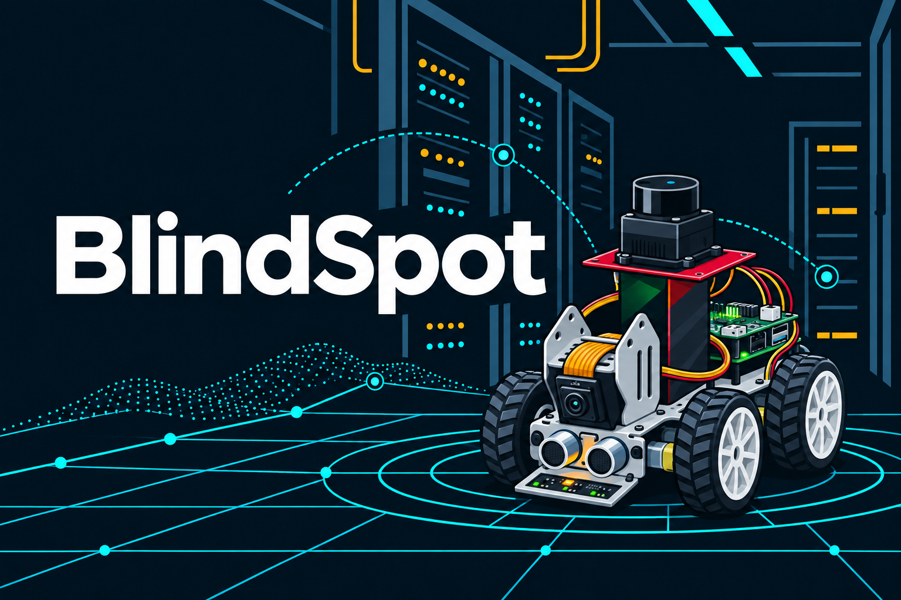
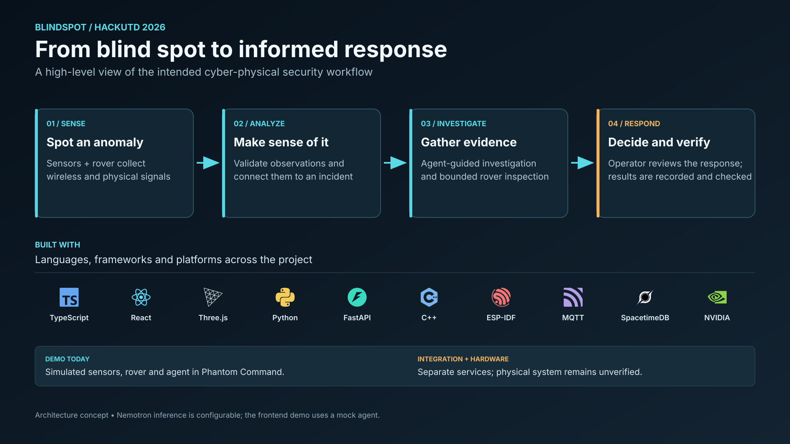
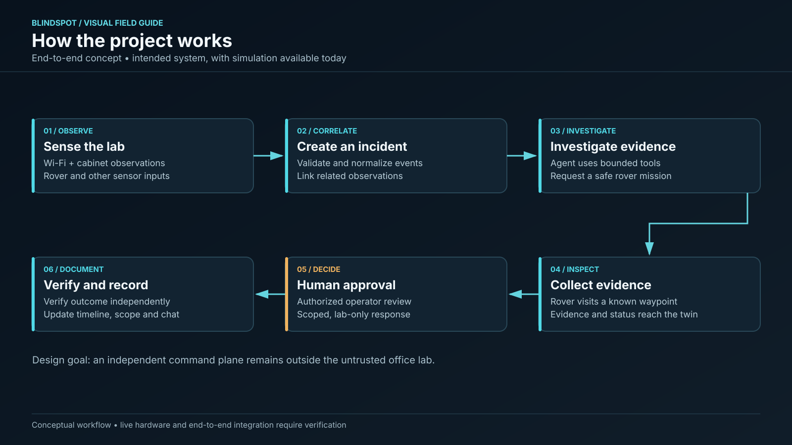
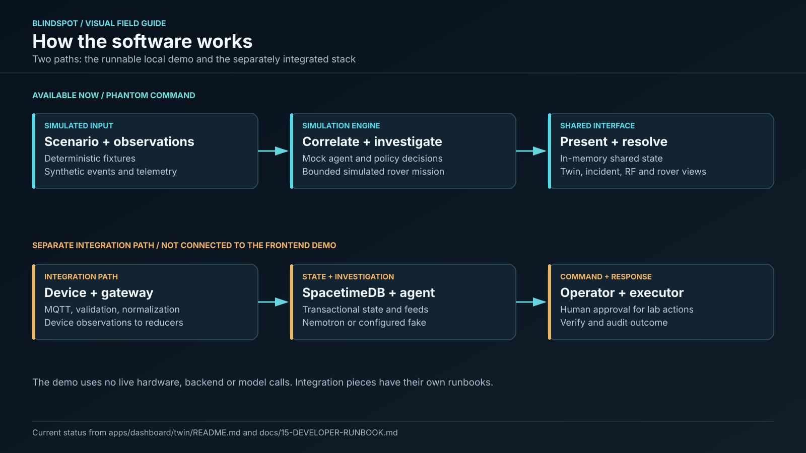
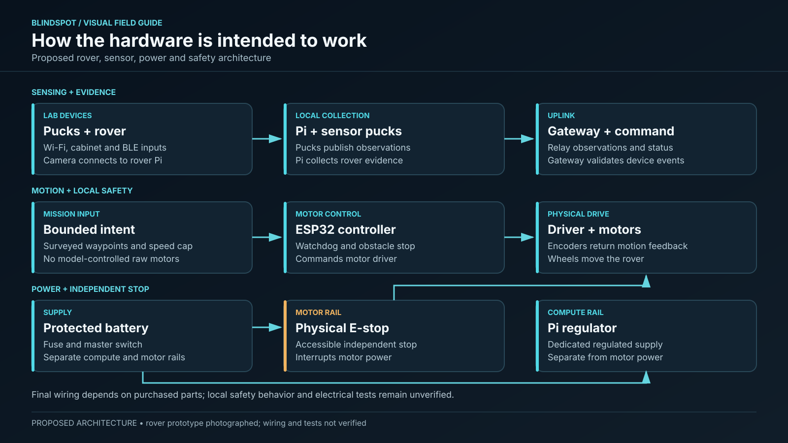
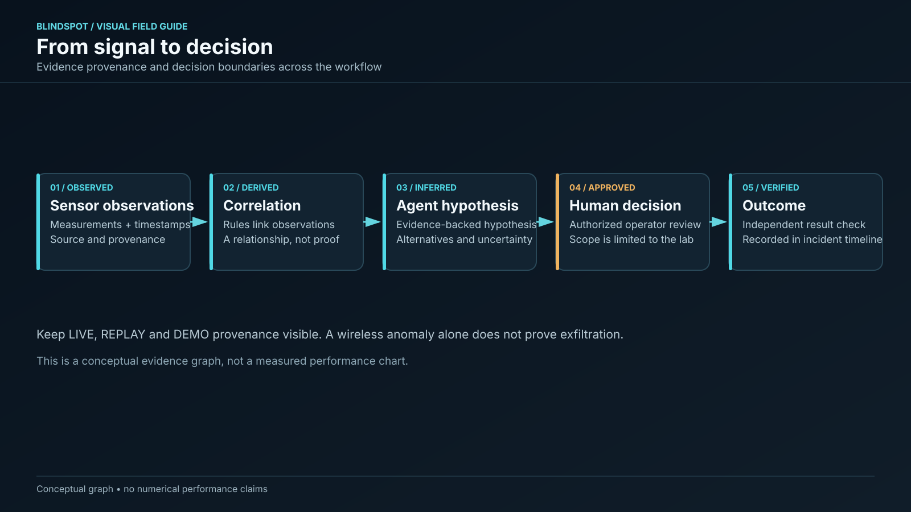

# BlindSpot — HackUTD 2026



*Stylized concept illustration based on photos of the rover prototype.*

**Autonomous cyber-physical defense platform** | NVIDIA Nemotron × Winstead × SpacetimeDB

BlindSpot is designed to bring a mobile security rover, wireless and physical sensors, and an independent incident command center together in an **owned mock enterprise office**. The intended system uses Nemotron for auditable investigations and SpacetimeDB for synchronized operational state, with human approval for limited lab response.

> **Frontend state:** Phantom Command is a complete, tested local simulation. Live hardware, model inference, production authorization and sponsor compliance remain separate verification work.

## How it works



The overview is a high-level view of the intended system. Phantom Command currently runs as a local simulation, while the live services and physical hardware require separate integration and verification.

### Project flow



The flow above shows the intended end-to-end system. The current Phantom Command frontend is a local simulation; the physical rover and end-to-end live integration still need verification.

### Software flow



Phantom Command runs entirely in memory with synthetic observations and a deterministic agent. The gateway, SpacetimeDB, agent, and lab executor are part of a separate integration path; they are not connected to the frontend demo. See the [frontend walkthrough](apps/dashboard/twin/README.md) and [developer runbook](docs/15-DEVELOPER-RUNBOOK.md).

### Proposed hardware flow



The planned rover uses a Raspberry Pi for mission handling and an ESP32 for local motor control, with an independent physical E-stop and watchdog. Sensor pucks provide separate observations. The team’s photos show an assembled rover prototype. This diagram describes the proposed architecture; the photos alone do not establish its wiring, safety behavior, or test status. The [hardware status and bring-up plan](hardware/README.md) describes the proposed design, but its statement that no hardware has been assembled predates the supplied prototype photos.

### Evidence and decisions



Observations, derived correlations, agent hypotheses, human approvals, and verified outcomes are distinct. A wireless anomaly alone is not proof of exfiltration. Demo and replay data must remain clearly labeled.

The [visual kit](docs/visuals/README.md) includes slide-ready PNGs, editable SVGs, and additional AI-generated concept art.

## Phantom Command

The [command center](apps/dashboard/twin/README.md) implements six connected workspaces: Command Overview, Digital Twin, Network Intelligence, Incident Center, Rover Operations and Nemotron Intelligence. A deterministic agent automatically correlates observations, creates incidents, dispatches policy-controlled rover inspections, collects synthetic evidence and publishes findings. It includes 3D occupancy geometry, 32 shared device records, scenario controls, human approval for disruptive mock actions, a simulated independent E-stop, and typed future ROS 2/Kismet/Nemotron adapters.

Run the local demo:

```sh
cd apps/dashboard/twin
npm ci
npm run dev
```

Open the local URL printed by Vite. The demo requires no live hardware, model endpoint, or external services. For supported Node versions and a scenario walkthrough, see the [frontend README](apps/dashboard/twin/README.md).

Start with [AGENT_HANDOFF.md](AGENT_HANDOFF.md) and the [demo walkthrough](apps/dashboard/twin/README.md). The component laboratory remains at `/lab.html`, and the original twin at `/legacy.html`. Every frontend action is explicitly simulated.

## Engineering execution tracker

- [Issue execution board: epics → implementation → FINALIZE → GLUE → deployment](docs/12-ISSUE-EXECUTION-BOARD.md)
- [GitHub Issues](https://github.com/ch1kim0n1/hackutd26/issues) — assigned work and acceptance evidence
- [Final deployment/release gate #55](https://github.com/ch1kim0n1/hackutd26/issues/55)

## Read first

1. [Project charter / ownership / definition of done](docs/00-PROJECT-CHARTER.md)
2. [Architecture and trust boundaries](docs/01-SYSTEM-ARCHITECTURE.md)
3. [**Winstead's exact required components and pass/fail tests**](docs/06-WINSTEAD-COMPLIANCE.md) — **mandatory**
4. [Implementation sprint and team work allocation](docs/09-IMPLEMENTATION-PLAN.md)
5. [Test matrix and live demo runbook](docs/10-TEST-AND-DEMO.md)

## Engineering reference

| Domain | Spec | Owner focus |
|---|---|---|
| Hardware, power, safety, procurement | [02-HARDWARE](docs/02-HARDWARE.md) | Robotics/hardware |
| Rover navigation and RF collection | [03-ROBOTICS-RF](docs/03-ROBOTICS-RF.md) | Robotics + security |
| State, reducers, typed messages | [04-DATA-AND-INTERFACES](docs/04-DATA-AND-INTERFACES.md) | Backend |
| NVIDIA Nemotron agent / tools | [05-NEMOTRON](docs/05-NEMOTRON.md) | AI engineer |
| React + Three.js twin, RF console, command UX | [07-COMMAND-CENTER](docs/07-COMMAND-CENTER.md) | Frontend |
| Attack boundaries and defenses | [08-SECURITY-THREAT-MODEL](docs/08-SECURITY-THREAT-MODEL.md) | Security |
| References and decisions | [11-REFERENCES-AND-DECISIONS](docs/11-REFERENCES-AND-DECISIONS.md) | Everyone |

## Three challenge mappings

- **NVIDIA:** real Nemotron agent; evidence-based planning, tools and bounded missions beyond chatbot output.
- **Winstead:** five hard requirements: isolated security; admin user management; live incident documentation; explicit compromised-data scope; integrated real-time team chat. **Assume attacker access to all internal office systems**—trusted command plane must remain independently secure. See [full checklist](docs/06-WINSTEAD-COMPLIANCE.md).
- **SpacetimeDB:** central transactional engine and real-time subscriptions driving sensors, missions, incidents, evidence, permissions projections, approvals and response state. Not merely chat/robot movement.

## Planned physical demonstration

The following is the target demonstration, not a claim that the end-to-end hardware workflow has been completed.

1. Owned unknown Wi-Fi AP appears near mock cabinet; sensor detects unfamiliar BSSID, cabinet contact opens.
2. Gateway validates real observations, creates correlated incident through SpacetimeDB.
3. Nemotron inspects inventory and RF evidence, requests safe rover inspection.
4. Rover navigates to known waypoint, captures time-stamped evidence.
5. 3D twin shows mission/incident; RF console shows **actual Wi-Fi channel activity** and evidence provenance. True SDR FFT waterfall is optional and requires actual IQ capture.
6. Authorized Commander and Responder use incident-specific live chat, data-impact scope matrix, and auditable approval flow.
7. Executor isolates only allowlisted owned lab endpoint, verifies outcome, and stores timeline and evidence manifest.

## Important security / safety rules

No general network attacks, wireless deauth/jamming, arbitrary LLM-run shell, direct LLM motor control, or unapproved disruptive containment. The rover must have independent E-stop + watchdog; office network is untrusted. No claim of proven exfiltration from Wi-Fi anomalies. Simulations/replays must be labeled.

## Contribution protocol

- Read the relevant spec and Winstead security checks **before** coding.
- API/schema changes require simultaneous update to [04-DATA-AND-INTERFACES](docs/04-DATA-AND-INTERFACES.md).
- Security/UX changes require testing against [06-WINSTEAD-COMPLIANCE](docs/06-WINSTEAD-COMPLIANCE.md).
- Implementation must record test outcomes with evidence; descriptions in docs are not proof.
- Resolve hardware part numbers, identity host, model endpoint and SDK versions in [open decisions](docs/11-REFERENCES-AND-DECISIONS.md).

**Source:** HackUTD 2026 sponsor slide photographs provided by the team, with vendor API references linked in docs. Sponsor participation and cross-track submission policy require independent confirmation.
