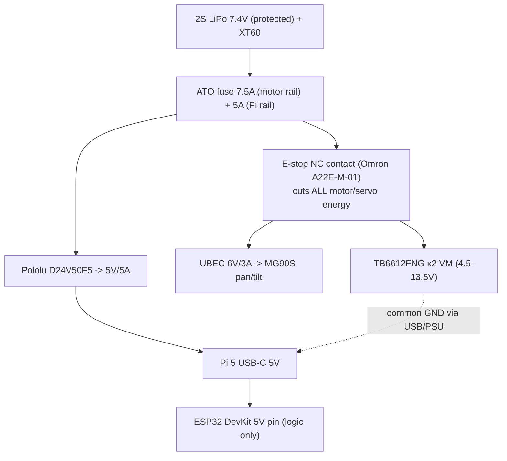

# Wiring Diagram — SENTINEL HIVE rover + pucks

**Status: PROPOSED — pending procurement freeze and multimeter verification.**
Pin assignments below target the specific part numbers in `hardware-bom.csv`.
Per `docs/02-HARDWARE.md`: *"Pin-by-pin wiring MUST be created after selecting
actual purchased part numbers; do not publish imaginary pinouts."* Every pin map
here must be re-verified against the purchased boards' silkscreen/datasheet
before energizing. Known pin-budget conflicts are logged at the bottom.

Signal levels: ESP32/Pi logic is 3.3 V. NeoPixel data at 3.3 V is acceptable for
the short runs inside the rover (<30 cm) with a 470 Ω series resistor; re-check
if the ring is moved farther away. Servo signal wires share ground with the Pi.

## 1. Power tree

Rules enforced by this tree:

- **No motor power from Pi GPIO.** Motors/servos are powered only from the
  fused, E-stop-switched battery rail.
- **E-stop removes motor energy mechanically** (NC contact in series), not just
  a logic signal. The NO contact of the same button feeds `GPIO34` on the ESP32
  so firmware can report `estop` fault state and refuse re-enable until cleared.
- **Independent rails:** Pi rail (5 V via D24V50F5) and motor/servo rail
  (battery direct through E-stop + fuse) share only ground. Pi brownout under
  drive load is test H10.
- All connectors strain-relieved; battery lead fused within 7.5 cm of pack.

## 2. Raspberry Pi 5

| Function | Pi pin | Connects to | Notes |
|---|---|---|---|
| Power in | USB-C PWR | D24V50F5 5 V out | 5 A rail; verify no drop under load (H10) |
| Camera | CSI/DSI CAM | Camera Module 3 | CSI-2 ribbon; enable in raspi-config |
| USB serial | USB-A | ESP32 DevKit USB | CP2102/CH340 UART bridge — command/telemetry link |
| I2C (optional rear ToF) | GPIO2/SDA, GPIO3/SCL (pins 3/5) | VL53L1X #2 (fallback only) | See conflict log C-1 |
| Servo PWM pan | GPIO12 (pin 32) | MG90S #1 signal | Verify PWM peripheral on Pi 5 at assembly |
| Servo PWM tilt | GPIO13 (pin 33) | MG90S #2 signal | Same |
| GND | pins 6/9/14/20/25/30/34/39 | Servo GND, common ground | Required for PWM reference |
| Status | GPIO18 (pin 12), 470 Ω | onboard status LED (optional) | Pi-side heartbeat only |

Do NOT use Pi GPIO to power or drive motors. Servo signal current is <10 mA.

## 3. ESP32 rover controller (ESP32-DevKitC V4, classic WROOM-32)

Firmware: `robotics/firmware/` (ESP-IDF). Pin budget is the tightest part of
this design — assignments verified against DOIT DevKit V4 pinout; **re-verify
silkscreen on the purchased unit**.

| Signal | ESP32 GPIO | Connects to | Direction | Notes |
|---|---|---|---|---|
| PWMA | 25 | TB6612 #1 PWMA | out | Left-side speed (PWM 20 kHz) |
| AIN1 | 26 | TB6612 #1 AIN1 | out | Left direction |
| AIN2 | 27 | TB6612 #1 AIN2 | out | Left direction |
| PWMB | 4 | TB6612 #2 PWMB | out | Right-side speed |
| BIN1 | 5 | TB6612 #2 BIN1 | out | Right direction |
| BIN2 | 18 | TB6612 #2 BIN2 | out | Right direction |
| STBY | 33 | TB6612 #1+#2 STBY (tied) | out | HIGH = drivers enabled; firmware holds LOW on any fault |
| LF_A | 13 | Left encoder channel A | in | PCNT; 10 kΩ pull-up to 3V3 |
| LF_B | 14 | Left encoder channel B | in | PCNT; 10 kΩ pull-up |
| RF_A | 16 | Right encoder channel A | in | PCNT; 10 kΩ pull-up |
| RF_B | 17 | Right encoder channel B | in | PCNT; 10 kΩ pull-up |
| I2C SDA | 21 | VL53L1X #1 SDA (+ #2 if on-ESP32) | bidir | 4.7 kΩ pull-up to 3V3, one pair only |
| I2C SCL | 22 | VL53L1X #1 SCL (+ #2 if on-ESP32) | bidir | 4.7 kΩ pull-up |
| XSHUT0 | 19 | VL53L1X #1 XSHUT | out | Sequential boot for address assignment |
| XSHUT1 | 20 | VL53L1X #2 XSHUT | out | Only if both ToFs on ESP32 — see C-1 |
| ESTOP_STAT | 34 | E-stop NO contact | in | 10 kΩ pull-down; HIGH = e-stop pressed |
| LED_DATA | 23 | NeoPixel ring DIN | out | 470 Ω series resistor |
| 5V | 5V pin | Pi rail 5 V (or separate 5 V) | in | Logic power only — never motor VM |
| GND | GND | Common ground | — | Star ground at battery negative |
| USB | micro-USB | Pi USB port | — | Serial protocol + 5 V logic feed |

Avoided pins: 0/2/15 (strapping), 6–11 (flash), 1/3 (UART0 to USB bridge —
firmware logs only), 12 (MTDI strapping). GPIO34–39 are input-only and used
only for switch/sensor inputs.

TB6612 wiring per chip: `VM`→motor rail (post-E-stop, fused), `VCC`→3V3,
`GND`→common, `AO1/AO2`→motor terminals. Motors never share Pi 5 V.

## 4. Sensor pucks

All pucks: USB-C powered from a **powered hub on the lab LAN side** (never from
the Pi). Each emits schema-v1 canonical events per `docs/04` with per-device
HMAC credential, monotonic `seq`, UTC `observed_at`, and LED state.

### Puck A — Wi-Fi scan (ESP32-S3-DevKitC-1)

| Signal | GPIO | Notes |
|---|---|---|
| LED | 48 (verify vs flash/PSRAM variant) | Status: solid=ok, blink=scan, off=fault |
| 5V/GND | USB-C | Powered hub; ~300 mA peak during scan |

No external sensors — `esp_wifi` scan on 2.4 GHz only. Authorized-SSID/BSSID
inventory is compiled into firmware config (Kconfig) and refreshed over the
management channel; unknown-BSSID tagging happens downstream in `apps/rf-intel`.

### Puck B — cabinet reed (ESP32-DevKitC V4)

| Signal | GPIO | Notes |
|---|---|---|
| REED | 34 | Input-only pin, ideal for switch; 10 kΩ pull-up, switch to GND |
| LED | 4 | Status LED + 330 Ω |
| 5V/GND | USB-C | Powered hub |

Reed magnet on cabinet door; firmware debounces (≥50 ms stable) and enforces the
authorized maintenance window before flagging `cabinet_open`.

### Puck C — BLE observer (ESP32-DevKitC V4)

| Signal | GPIO | Notes |
|---|---|---|
| LED | 4 | Status LED + 330 Ω |
| 5V/GND | USB-C | Powered hub |

Passive BLE observer: reports only MAC/UUIDs on the enrolled lab-beacon
allowlist. No people tracking, no active transmit beyond standard BLE scan.

## 5. Conflict log (must resolve before energizing)

- **C-1 ToF I2C address budget.** VL53L1X boots at 0x52; two sensors need
  sequential XSHUT (GPIO19 + GPIO20). If the purchased DevKit does not break out
  GPIO19/20, fallback: rear ToF moves to Pi I2C (`/dev/i2i2c-1`, address 0x52)
  and ESP32 keeps only XSHUT0=19→remap. Decide at assembly; update this file.
- **C-2 ESP32 encoder count.** BOM allows 2WD or 4WD chassis. Map above assumes
  one encoder per side (4 wires). A 4WD kit with 4 encoder pairs needs 4 more
  GPIOs — not available without an I2C GPIO expander (e.g., MCP23017). Prefer a
  chassis with exactly 2 encoded motors, or accept averaged-side odometry.
- **C-3 E-stop contact rating.** A22E-M-01 must be ordered in 1NO+1NC maintained
  configuration; NO→GPIO34 telemetry, NC→motor rail cut. Verify contact rating
  ≥ worst-case motor stall current after H-gate measurement; add a relay if
  marginal.
- **C-4 Servo power.** MG90S stall ~500 mA each; UBEC 6 V/3 A covers both with
  margin. Servos must NEVER be powered from the Pi 5 V rail.
- **C-5 NeoPixel at 3.3 V.** Works at short range; if flicker appears, add a
  74AHCT125 level shifter on DIN.

## 6. Bring-up order (gates from docs/02)

1. H01: multimeter-check every rail **with Pi disconnected**; log voltages.
2. H02: bench-test motors with wheels raised.
3. H03: prove E-stop removes motor energy (measure VM = 0 V at drivers).
4. H04: disconnect Pi USB mid-drive → firmware watchdog stops motors ≤ TTL.
5. H05: obstacle stop with hand before ToF.
6. H06: AprilTag + encoder odometry calibration.
7. H07: camera photo carries correct zone/time.
8. H08: each puck emits authenticated, sequenced observations.
9. H09: five repeatable safe patrols.
10. H10: no Pi brownout under drive load (scope 5 V rail during patrol).

Record results in `hardware/test-evidence/` (see its README for templates).
